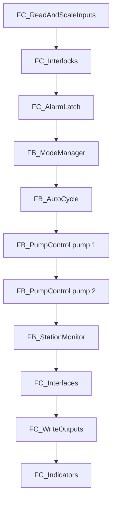

# TIA Portal Notes

## Project

| Item | Value |
| --- | --- |
| Project | SPS_SmartPumping_V1 (TIA Portal V18) |
| Device | PLC_Station, CPU 1214C DC/DC/DC, firmware V4.x (highest available) |
| Signal modules | 2 x SM 1231 AI 4 x 13 bit (slot 2 at %IW64, slot 3 at %IW72) |
| Analog channels | Current 4 to 20 mA, scaled 0 to 27648 |
| Onboard analog inputs | Moved to %IW80 and %IW82, unused |
| Clock memory | Byte MB0, Clock_1Hz = %M0.5 |
| Simulation | S7-PLCSIM V18 SP2 |

## Blocks and languages

| Group | Block | Language | Role |
| --- | --- | --- | --- |
| Main | OB1 | SCL | Orchestration only |
| IO | FC_ScaleAnalog, FC_ReadAndScaleInputs, FC_WriteOutputs | SCL | Scaling, effective values, pump outputs |
| IO | FC_Indicators | LAD | Lamps and siren |
| Control | FB_ModeManager | SCL | State machine |
| Control | FC_Interlocks | SCL | Fault causes, source availability |
| Control | FC_AlarmLatch | LAD | Latched critical alarms and reset |
| Control | FB_PumpControl | SCL | Level hysteresis, pump logic |
| Process_Sim | OB30, FC_SimulationModel | SCL | Tank model at 100 ms |
FC_Interlocks | FB_PumpControl (two instances) | FB_AutoCycle

SCL sources are in `03_plc/src` and are the reference. Ladder blocks are documented with screenshots in `captures/`.

## Naming

| Prefix | Meaning |
| --- | --- |
| OB | Organization block |
| FB / FC | Function block / function |
| DB | Data block |
| DI_ AI_ DO_ | Digital input, analog input, digital output tags |
| IO | FC_Interfaces | SCL | Fills DB_HMI, clears operator pump commands outside Manual and Maintenance |

## Call order in OB1

Pump 2 is evaluated after pump 1 and reads its run command, so when both are requested in the same scan, pump 1 starts and pump 2 is refused.