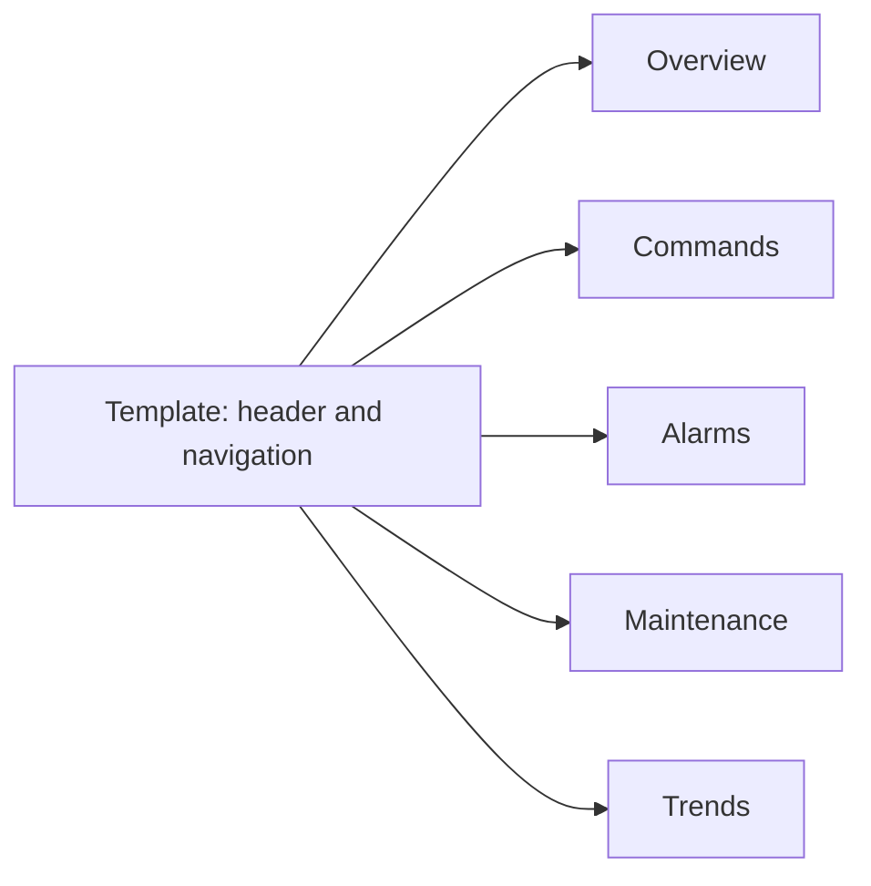

# HMI Design Standard

## Platform

WinCC RT Professional (PC based), TIA Portal V18, simulated with WinCC Runtime Professional Simulation V18 against S7-PLCSIM V18 SP2. Screen resolution: 1366 x 768 (update if different). The HMI reads and writes only DB_HMI, which FC_Interfaces fills. Connection: HMI connection, PLC at 192.168.0.1, HMI at 192.168.0.2.

## Screens

| Screen | Purpose |
| --- | --- |
| Overview | Process synoptic: source, pumps, tank, measurements, global state |
| Commands | Start, Stop, Reset, mode selection, manual pump commands |
| Alarms | Active alarms with priority and acknowledgment |
| Maintenance | Run hours, start counts, sensor and pump state |
| Trends | Level, flow, pressure and pump state over time |

## Colors

| Meaning | Color | RGB |
| --- | --- | --- |
| Normal, running confirmed | Green | 46, 125, 50 |
| Warning, unavailable, maintenance | Orange | 239, 108, 0 |
| Critical | Red | 198, 40, 40 |
| Water | Blue | 21, 101, 192 |
| Starting, transition | Light blue | 100, 181, 246 |
| Inactive, stopped | Grey | 158, 158, 158 |
| Screen background | Light grey | 236, 239, 241 |
| Text | Dark grey | 33, 33, 33 |

White text on green, orange, red and blue. Dark text on light blue and grey.

## Rules

- Color is never the only indicator. Every state also has a text, and warning and critical states carry an ASCII symbol: `[ OK ]`, `[ ! ]`, `[ X ]`.
- A run command and a run feedback are displayed separately. A command without feedback shows STARTING, then UNAVAILABLE after the timeout.
- Font: Segoe UI. Title 20, labels 12, values 16.
- Values are rounded to what is useful: levels and flow with one decimal, pressure with one decimal, currents with one decimal.
- The same palette and vocabulary are used in every screen.