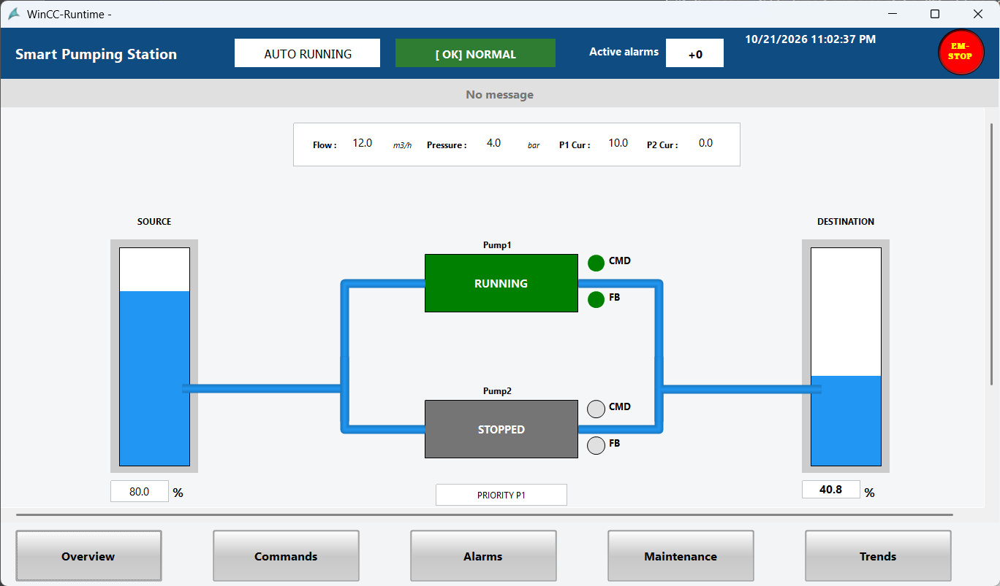
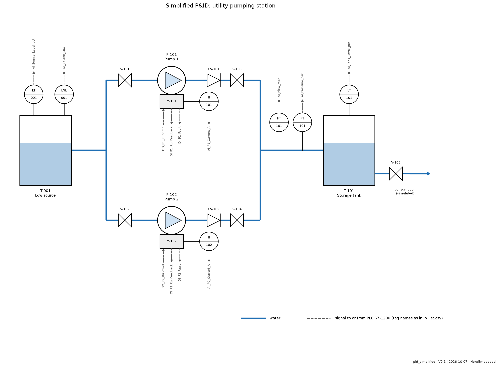
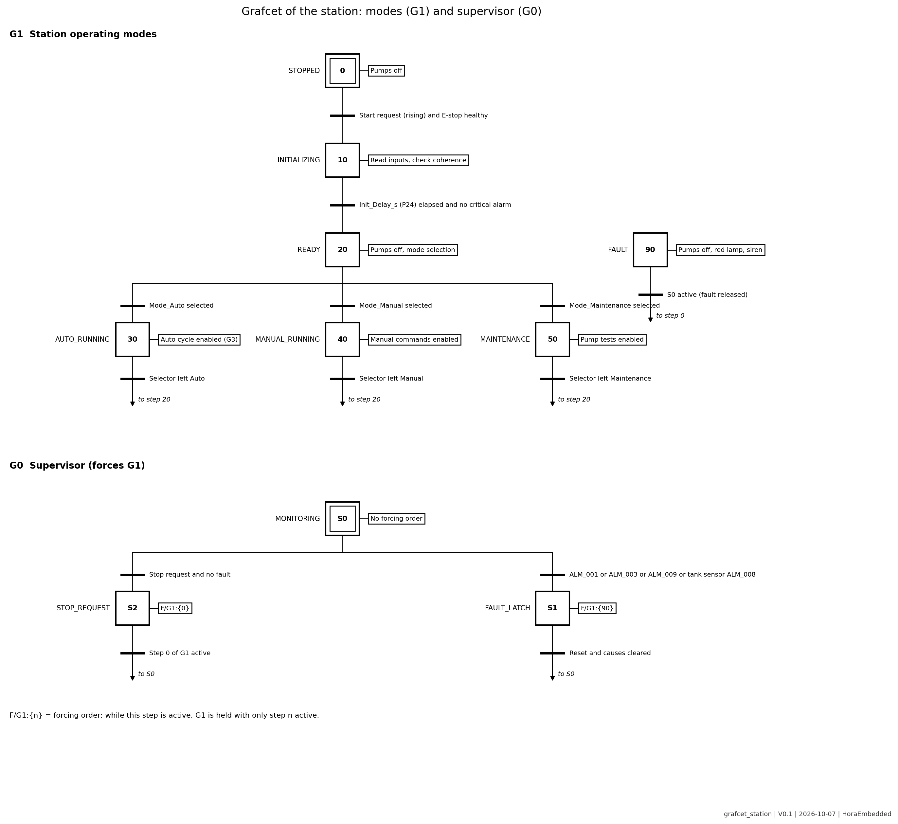
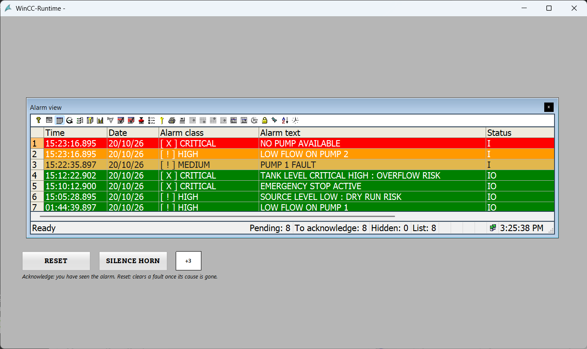
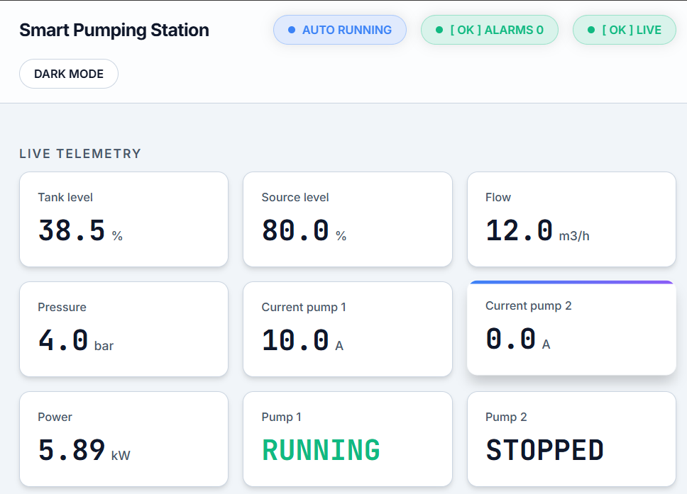
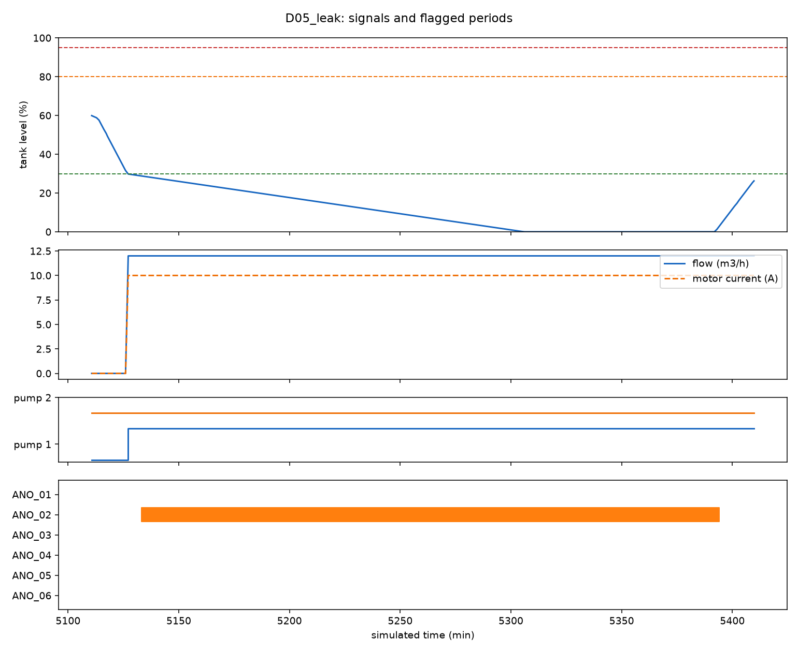

# Smart Pumping Station

**Station de pompage d'utilité industrielle : commande PLC, IHM, suivi de fiabilité et détection explicable d'anomalies**

[English version](README.md) | [Rapport technique](08_report/report_final.pdf) | [Vidéo de démonstration](https://youtu.be/cKYuNFylUhU)

## Objet du projet

Une station d'utilité à deux pompes qui maintient un réservoir entre deux niveaux, conçue comme un cas d'ingénierie complet : exigences, conception, programme PLC, IHM, données, indicateurs, règles d'anomalies et campagne de tests vérifiée.

| Chiffres clés | |
| --- | --- |
| Exigences | 56, chacune avec un test |
| Tests | 69, tous passés sur la version figée |
| PLC | S7-1200, 14 blocs de code, SCL et Ladder |
| Alarmes | 13, en quatre classes |
| Jeux de données | 6, un normal et cinq avec défaut injecté |
| Règles d'anomalies | 6, chaque alerte expliquée |
| Décisions consignées | 61 |

## Contexte industriel

Les stations d'utilité amènent l'eau vers un réservoir qui alimente une usine. Elles doivent éviter la marche à sec, les démarrages excessifs, le débordement et un redémarrage dangereux après un défaut critique.

## Exigences fonctionnelles

56 exigences testables rédigées avec « shall », une méthode de vérification chacune, et une matrice de traçabilité contrôlée par script dans les deux sens. Voir les [exigences](01_requirements/requirements.md) et la [matrice de traçabilité](01_requirements/requirements_traceability_matrix.csv).

## Hypothèses et limites

Hypothèses du modèle : réservoir de 10 m3, pompe de 12 m3/h, consommation constante de 3 m3/h, procédé simulé dans le PLC, signaux 4-20 mA simulés. Voir les [hypothèses](01_requirements/assumptions.md).

Limites, énoncées une seule fois :
- Validation en simulation (S7-PLCSIM, WinCC Runtime), sans automate ni capteur physique.
- Indicateurs et jeux de données issus de la simulation : ils illustrent le calcul, ce ne sont pas des statistiques de terrain.
- Arrêt d'urgence et défauts verrouillés en logique simulée, pas une chaîne de sécurité certifiée. Le bouton d'arrêt d'urgence sur l'IHM est une action supplémentaire, l'arrêt d'urgence de référence reste le contact câblé.
- Aucune conformité IEC 62443 revendiquée, point d'accès OPC UA anonyme sur le PC de laboratoire seulement.
- Seuils issus d'une simulation sans bruit, leurs marges sont à remesurer sur des données de terrain.
- Les règles d'anomalies ont des angles morts documentés, voir les [règles](docs/anomaly_rules.md).

## Architecture du système

## P&ID et table des E/S

24 signaux (12 entrées digitales, 6 entrées analogiques, 6 sorties digitales) : [liste des E/S](02_design/io_list.csv).

## Architecture PLC

Siemens S7-1200, TIA Portal V18. OB1 se contente d'orchestrer, le modèle du réservoir tourne dans une interruption cyclique de 100 ms, les seuils sont dans un seul bloc de paramètres, aucune adresse brute dans le code.

| Bloc | Rôle |
| --- | --- |
| FB_ModeManager | Machine à états |
| FB_AutoCycle | Demande de niveau, alternance, secours |
| FB_PumpControl | Commande de marche, délai anti-redémarrage, contrôles de débit et de retour, compteurs |
| FB_StationMonitor | Démarrages fréquents, maintenance, montée de niveau, avertissements de capteurs |
| FC_AlarmLatch, FC_Indicators | Alarmes verrouillées, voyants et sirène (Ladder) |

Détails dans les [notes TIA Portal](03_plc/notes_tia_portal.md). Les sources sont versionnées dans `03_plc/src`, l'archive du projet est jointe à chaque release.

## Modes de fonctionnement

Sept états (arrêt, initialisation, prêt, auto, manuel, maintenance, défaut), tout changement de mode passe par l'état prêt. Défauts critiques verrouillés, reset seulement quand la cause a disparu, aucun redémarrage automatique. Voir la [machine à états](02_design/mode_state_description.md).

## Stratégie d'alarmes

Inspirée de l'ISA-18.2 : chaque alarme exige une action, l'acquittement n'efface jamais un défaut, la sirène se réarme sur une nouvelle alarme critique. Voir la [matrice d'alarmes](02_design/alarm_matrix.csv) et la [philosophie d'alarmes](docs/alarm_philosophy.md).

## IHM

WinCC Runtime Professional V18, cinq écrans, système d'alarmes natif avec textes d'aide, états toujours écrits en texte. Un bouton d'arrêt d'urgence est disponible sur chaque écran : un seul appui, sans confirmation, agit comme le contact d'arrêt d'urgence ; son relâchement demande une confirmation. Voir le [guide opérateur](04_hmi/operator_guide.md).

## Architecture des données et des indicateurs

Le serveur OPC UA du Runtime WinCC est lu par un client Python en lecture seule. Les indicateurs sont pondérés par le temps, la disponibilité est donnée au niveau de la station et de chaque pompe. Un tableau de bord local en lecture seule les affiche en direct.

Voir l'[architecture des données](docs/data_architecture.md), les [définitions des indicateurs](docs/kpi_definitions.md) et les [jeux de données](05_iiot_data/datasets/README.md).

## Règles de détection d'anomalies

Six règles sur les signaux mesurés, chaque alerte donne les valeurs et le seuil franchi. Évaluées contre des défauts injectés, avec des marges de seuils mesurées. Voir les [règles](docs/anomaly_rules.md) et les [résultats](05_iiot_data/anomaly_results.md).

## Plan de tests et résultats

69 tests rejoués sur une version figée, cinq scénarios de recette de bout en bout plus les deux tests d'arrêt d'urgence IHM, défauts consignés avec cause et correctif. Voir le [plan de tests](06_tests/test_plan.md), le [rapport final](06_tests/test_report_final.md) et le [registre des défauts](06_tests/defect_log.md).

## Démonstration

Quatre minutes de la station en fonctionnement : [vidéo sur YouTube](https://youtu.be/cKYuNFylUhU). Script dans [07_media](07_media/demo_script.md). Pour la rejouer, suivre le [runbook](docs/runbook.md).

## Améliorations futures

- Sécuriser le point d'accès OPC UA (messages signés et chiffrés, gestion des certificats)
- Évaluation de sécurité par zones et conduits (IEC 62443)
- Portage sur S7-1500 pour PLCSIM Advanced et un serveur OPC UA natif
- Détection de fuite par résidu de bilan de masse
- Détecteur statistique ou appris évalué contre les règles sur des données de terrain
- Panneau IHM physique avec profils d'utilisateurs, banc matériel en boucle

## Structure du dépôt

| Dossier | Contenu |
| --- | --- |
| `01_requirements/` | Périmètre, hypothèses, exigences, cas d'usage, traçabilité |
| `02_design/` | P&ID, liste des E/S, matrice d'alarmes, machine à états, diagrammes |
| `03_plc/` | Sources SCL, exports, notes TIA Portal |
| `04_hmi/` | Écrans, guide opérateur, standard de conception |
| `05_iiot_data/` | Jeux de données, code Python, tableau de bord, figures, résultats |
| `06_tests/` | Plan de tests, résultats, campagne, registre des défauts, preuves |
| `07_media/` | Script de démonstration et notes sur la vidéo |
| `08_report/` | Rapport technique (source LaTeX et PDF) |
| `docs/` | Procédé, paramètres, runbook, journal de décisions, glossaire |
| `tools/` | Génération des figures, campagne, vérification, analyse d'impact |

## Licence

MIT, voir [LICENSE](LICENSE).