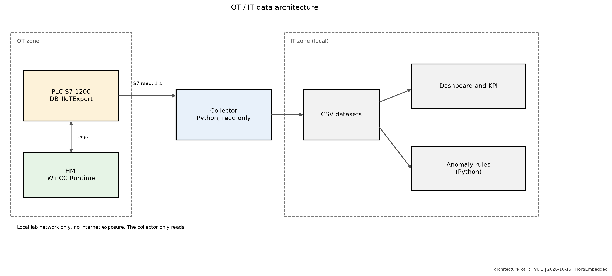

# Data Architecture

## Data flow

| Stage | Component | Role |
| --- | --- | --- |
| Source | PLC, DB_IIoTExport | Flat data block refreshed every scan, one sample per second |
| Transport | S7 communication, read only | The collector reads 70 bytes every 0.5 s |
| Collection | collector.py | Adds the PC timestamp, keeps only new samples, counts missed ones |
| Storage | CSV files in 05_iiot_data/datasets | One file per run, one row per sample |
| Use | Dashboard, KPI, anomaly rules | Read the CSV files |

The column list is in 05_iiot_data/data_dictionary.md.

## Time bases

| Column | Clock | Use |
| --- | --- | --- |
| Timestamp | PC clock, UTC, applied at reading | Alignment with external events |
| SampleCounter | PLC, +1 per real second | Gap detection, delays that run in real time |
| SimTime_s | Process model, step times acceleration | Rates per simulated hour, cycle durations |

Protection delays (flow validation, restart delay, feedback timeout) run in PLC real seconds. The process dynamics and the frequent-start window run on simulated time. At acceleration 1 both clocks are equal.

## Sampling

One sample per second. The shortest protection delay is 5 s, so every delay spans at least five samples. The collector polls every 0.5 s so that no sample is lost between two counter increments.

## Security measures

| Measure | How |
| --- | --- |
| No Internet exposure | PLC and collector on a local network with private addresses, no port forwarding |
| Read only collector | The code only calls the block read function and has no write call |
| PUT/GET access | Enabled on the CPU because S7 reading needs it. It has no authentication and gives access to any block by address, so the protection is the network isolation |
| No secrets in the repository | Nothing in the code needs a credential, `.gitignore` excludes `.env`, keys and certificates, a repository scan is part of the tests |
| Simulated field signals | Replaced by the physical inputs by switching `Sim_Inputs` off |